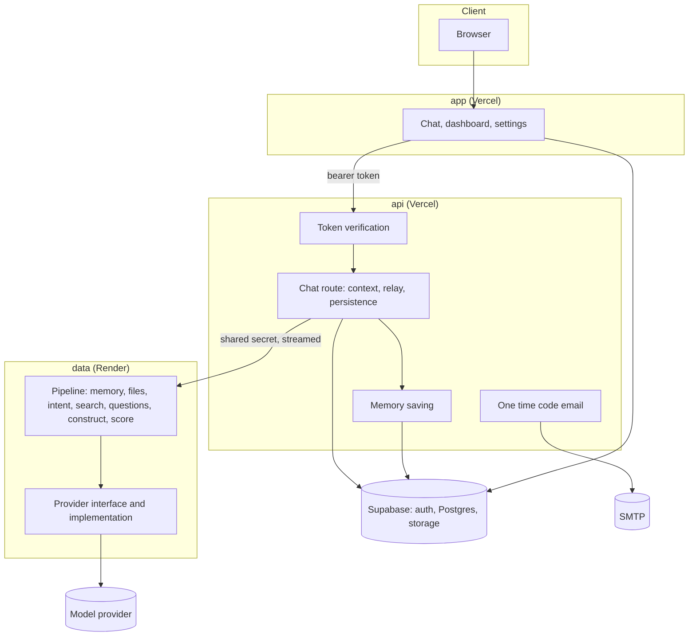
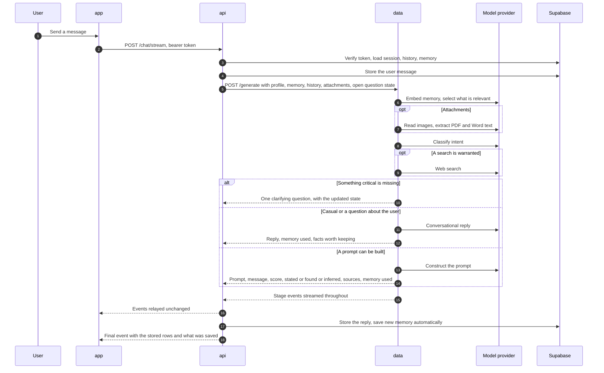

# Architecture

This document describes how Prompt AI is put together as it exists today, why it is split this way, and how a request moves through it.

## The three services

| | `app` | `api` | `data` |
|---|---|---|---|
| Responsibility | Interface | Identity, storage, business logic | Intelligence |
| Technology | Next.js | Express, TypeScript | FastAPI, Python |
| Hosted on | Vercel | Vercel | Render |
| Talks to | `api`, and Supabase for simple reads and writes | Supabase, `data`, SMTP | The model provider |
| Holds secrets for | Supabase anon key | Supabase service key, shared secret, mail | Model provider key, shared secret |
| Has a database | No | Yes | No |
| Knows who the user is | Via session | Verifies every token | Never |

Three rules keep the boundary honest.

1. **`data` is the only service that calls a model provider.** There is one provider implementation, behind an interface, and nothing else in the repository talks to one.
2. **`api` is the only caller of `data`.** `data` rejects any request without the shared secret.
3. **`data` is stateless.** It has no database and fetches nothing. `api` sends everything a request needs, the user's profile, stored memory, conversation history and any in progress question flow, and `data` works only with that. This is what makes it impossible for `data` to invent facts about a user it was never told about.

## Why this split

The boundary is drawn around what needs to change independently and what needs to scale independently. Authentication and storage change slowly and need to be reliable. Prompt wording, templates and providers change constantly as the pipeline is tuned. Keeping them apart means the intelligence layer can be redeployed, retuned or swapped out without touching authentication, and a spike in model load does not put sign in at risk.

`data` is intentionally ignorant of identity. It does not know who a user is, only that a request arrived with the shared secret. Even if it were compromised there would be no credentials, accounts or mail system to reach from there.

## System overview



## How a chat message flows



### Pattern retrieval

Before a prompt is constructed, the closest one or two entries in a library of known effective patterns are retrieved by meaning and handed to construction as craft guidance. The library is a file beside the code and its vectors are computed once per process, since `data` has no database. The retrieval sits behind one class, so a database backed vector store could replace it without touching the pipeline. Which patterns were used is returned with the result and shown to the user.

### Feedback

A thumbs up or down is written to the response it was given on, along with the request, the score and the template version. `data/evaluation/feedback_review.py` exports those ratings, summarizes them by template version and drafts eval cases from the thumbs down items. A person reviews the drafts and decides what changes. Nothing retrains or edits a template automatically.

### Stage events

`data` streams an event as each step actually begins, so the status a user sees describes real work. Stages are: reading attachments, understanding the request, searching, asking, answering, constructing, scoring and finalizing. Each stage has a pool of short and long phrasings, chosen at random. `api` relays every event without changing it and adds one final event of its own that carries the stored messages and anything saved to memory.

### The question flow

When a request is underspecified, `data` plans up to three questions and asks the first. Because `data` holds no state, the whole sequence, which questions exist, which are answered, any text read from attachments, travels in each response. `api` stores it on the assistant message and sends it back with the user's next message. A question is shown one at a time. A single choice question advances the moment an option is picked, and only multi select and free text answers need a confirm. A direct question asked mid sequence is answered without losing the pending question.

### Memory

- **Selection.** Every request, casual ones included, begins by embedding the message and the stored memory and keeping the items that bear on it. A message about the user themselves widens this to everything stored. What was used is returned with the reply and shown in the interface.
- **Saving.** While replying, `data` proposes stable facts it noticed. `api` decides what is stored: it skips low confidence proposals, secrets and long digit runs, repeats, and anything the user entered by hand, then saves automatically and reports it.
- **Control.** The settings memory page lets the user add, edit and delete anything.

### Attachments and search

Images arrive as data URLs and are read with vision. PDFs are fetched from storage by `api`, and Word documents are sent by the browser, both as bytes, and their text is extracted in `data`. What was read becomes part of the context before anything is constructed, and is listed back to the user. Web search is planned by the intent step only when a request depends on current information, and its findings and links are shown the same way.

## The data service

```
data/
  main.py            app entrypoint, startup validation
  config.py          settings, validated at startup
  routers/           generate, transcribe, title, health
  core/
    context.py       the one place memory, files and searches join the context
    events.py        stage events and their message pools
    providers/       provider interface and the OpenAI implementation
    prompts/         system prompts, versioned templates, output format targeting
    pipeline/        intent, clarify, ingest, research, construct, score
  schemas/           request and response models
  evaluation/        eval set and runner
  tests/             unit tests
```

Prompt templates are versioned in directories and one version is active at a time, so any result can be traced to the wording that produced it.

## The api service

| Route | Purpose |
|---|---|
| `GET /health` | Liveness |
| `POST /auth/otp/request-signup`, `/auth/otp/verify-signup` | Email sign up with a one time code |
| `POST /auth/otp/request-reset`, `/auth/otp/verify-reset` | Password reset with a one time code |
| `POST /auth/send-welcome` | Welcome email after OAuth sign in |
| `POST /chat/stream` | A chat turn, streamed |
| `POST /chat/transcribe` | Voice message to text, via `data` |
| `GET /chat/memory-summary` | A short prose description of what is stored about the signed in user, written by `data` |

## Data stores

- **Supabase Postgres** holds chat sessions, messages, saved prompts, shared links, exports and memory. `app` reads and writes simple records directly under row level security. `api` uses the service key for the chat route.
- **Supabase storage** holds image, video and PDF attachments.
- **Supabase auth** owns accounts and sessions.

## Failure handling

If `data` is slow, unreachable or returns something unusable, the user gets an honest error message with a retry action. Nothing is fabricated to cover for it. A failed search, an unreadable attachment or an embeddings outage degrades quietly: the reply is still produced, the unreadable file is reported as unreadable, and memory selection falls back to keyword matching. A failure to save memory never blocks a reply.

## Deployment

`app` and `api` are separate Vercel projects linked by environment variables. `data` runs on Render, which suits a long running Python process better than serverless functions. A scheduled workflow keeps the `data` service and the database awake on their free tiers. Each service validates its environment at startup and exits with a clear message if something required is missing.

## Planned routes

The interface grows in phases as the data model and user base justify it. Planned next: a models page and a rules page for user defined generation preferences, then community and feedback pages. Earlier phases are built on data models designed to support the later ones, so adding a route does not require a schema rewrite.
