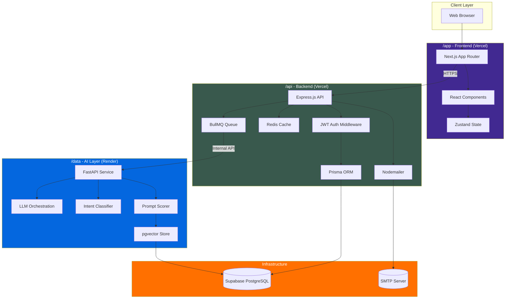
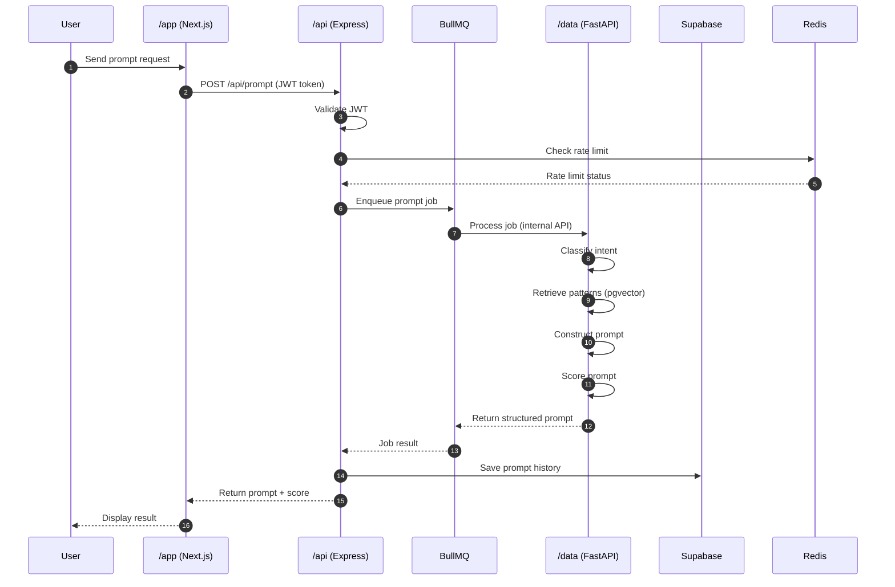
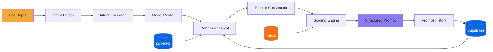
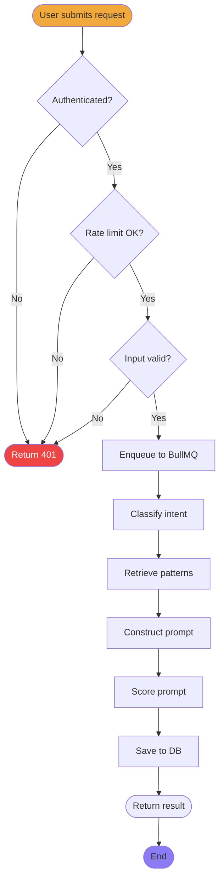

# Prompt AI

Prompt AI is a chat based tool that turns vague human intent into detailed, structured prompts that other AI tools can execute correctly on the first try. You describe what you want in plain language. Prompt AI asks the right questions, fills in the missing context, and returns a prompt built for the AI tool you actually need, whether that is a coding assistant, an image generator, a video model, or a general purpose chat model.

Live site: https://prompt.ai/
Repository: oyedokunken/Prompt-AI
Developed by: [oyedokunken](https://www.oyedokun.dev/) ([oyedokunken@gmail.com](mailto:oyedokunken@gmail.com))

This project is public and open to contributors. It is built for developers, by a developer, and it stays that way for now.

---

## Table of Contents

- [The Problem](#the-problem)
- [How Prompt AI Solves It](#how-prompt-ai-solves-it)
- [Architecture Overview](#architecture-overview)
- [Monorepo Structure](#monorepo-structure)
- [Tech Stack](#tech-stack)
- [Core Features](#core-features)
- [Edge Cases We Actively Handle](#edge-cases-we-actively-handle)
- [Getting Started](#getting-started)
- [Environment Variables](#environment-variables)
- [Running the Project](#running-the-project)
- [Project Roadmap](#project-roadmap)
- [Contributing](#contributing)
- [Documentation](#documentation)
- [License](#license)
- [Contact](#contact)

---

## The Problem

Most people know what they want but do not know how to describe it in a way an AI model can act on without guessing. The gap between "write me a blog post" and a prompt that actually produces a usable blog post is made up of dozens of unstated assumptions: audience, tone, length, structure, platform, constraints, and format. Every AI model, no matter how capable, fills that gap with its own guesses, and those guesses are usually wrong.

Prompt AI exists to close that gap before the prompt ever reaches the target model.

## How Prompt AI Solves It

Prompt AI treats prompt writing as three separate, solvable problems instead of one vague one.

1. **Intent Understanding.** The system identifies what the user is actually trying to accomplish, what information is missing, and which category of AI tool the request belongs to (code generation, image generation, video generation, writing, or agent based tasks).
2. **Prompt Construction.** Using proven prompt engineering patterns such as role definition, context, constraints, output format, and examples, Prompt AI builds a complete, structured prompt from the user's raw input.
3. **Scoring and Iteration.** Every generated prompt is scored against a rubric covering clarity, specificity, constraints, and format. The user sees the score, sees what was added or assumed, and can refine before copying the final prompt out to the destination AI tool.

The long term goal is a system that understands how other AI models think better than most humans do, and uses that understanding to write prompts on the user's behalf, while always showing the user exactly what was inferred versus what they actually said.

## Architecture Overview

Prompt AI is a monorepo split into four areas, each with a single responsibility.

- **`/app`** is the Next.js frontend. It owns the chat interface and everything the user sees.
- **`/api`** is the backend. It owns authentication, business logic, email (via Nodemailer), rate limiting, and every request that involves the database. It is the only service allowed to talk to `/data`.
- **`/data`** is strictly the AI layer. It hosts the LLM orchestration, classification, and scoring models, and exposes a narrow internal API that only `/api` calls. It has no auth, no email, and no direct client access.
- **`/docs`** holds architecture notes, prompt engineering pattern documentation, and contribution guides that don't belong in code.

`/app` and `/api` are deployed as two separate Vercel projects, linked by environment variables. `/data` is deployed on Render, since Render is better suited to long running Python processes than serverless functions are. Nodemailer runs from `/api` on Vercel rather than from `/data`, since Render does not handle SMTP style outbound mail as cleanly.

## System Diagrams

### Architecture Diagram



### Sequence Diagram



### Data Flow Diagram



### Activity Diagram



### Component Diagram

```mermaid
graph TB
    subgraph Frontend["Frontend Components"]
        Hero[Hero Section]
        Problem[Problem Section]
        Capabilities[Capabilities]
        ChatPreview[Chat Preview]
        DeviceFrame[Device Frame]
        ModelMarquee[Model Marquee]
        Testimonials[Testimonials]
        ClosingCTA[Closing CTA]
        Integrations[Integrations]
        Header[Header]
        Footer[Footer]
    end

    subgraph Shared["Shared Components"]
        Container[Container]
        Logo[Logo]
        ScrollToTop[ScrollToTop]
    end

    subgraph UI_Primitives["UI Primitives"]
        Button[Button]
        Card[Card]
        Badge[Badge]
    end

    Hero --> Container
    Problem --> Container
    Capabilities --> Container
    ChatPreview --> Container
    DeviceFrame --> Container
    ModelMarquee --> Container
    Testimonials --> Container
    ClosingCTA --> Container
    Integrations --> Container
    Footer --> Container

    Header --> Logo
    Footer --> Logo

    Button --> UI_Primitives
    Card --> UI_Primitives
    Badge --> UI_Primitives

    style Frontend fill:#412991,color:#fff
    style Shared fill:#8B7CF6,color:#fff
    style UI_Primitives fill:#F2A93B,color:#fff
```



## Monorepo Structure

```
Prompt-AI/
├── app/               Next.js chat interface and user dashboard (Vercel)
├── api/                Auth, business logic, email, and orchestration (Vercel)
├── data/               Python LLM and ML layer, model serving only (Render)
├── docs/               Architecture notes, guides, and pattern library docs
├── .github/            CI workflows and issue and PR templates
├── SECURITY.md
├── CONTRIBUTING.md
├── CHANGELOG.md
├── ARCHITECTURE.md
├── WIKI.md
└── README.md
```

Each folder is independently runnable and has its own dependency management, environment file, and README with service specific setup instructions.

## Tech Stack

### `/app` (Frontend)

- **Next.js (App Router)** for the chat interface, routing, and server rendered pages
- **TypeScript** across the entire frontend for type safety
- **Tailwind CSS** for styling
- **shadcn/ui** for accessible, composable UI primitives
- **React Hook Form** for form state and validation handling
- **Zustand** for lightweight client side state management
- **Zod** for runtime schema validation shared between forms and API responses
- Hosted on **Vercel**

### `/api` (Backend)

- **Node.js with Express** for the API layer
- **Prisma ORM** for type safe database access
- **Supabase (PostgreSQL)** as the primary database and storage provider
- **JWT (JSON Web Tokens)** for stateless authentication, with refresh token rotation
- **Nodemailer** for transactional email (verification, password reset, notifications)
- **Zod** for request and response validation on every route
- **dotenv with a Zod validated env schema** so the app fails fast on missing or malformed configuration instead of failing silently in production
- **Redis** for caching and rate limiting
- **BullMQ** for queuing outbound calls to `/data` and external AI providers, so a slow response never blocks a request thread
- Hosted on **Vercel**, as a separate project from `/app`

### `/data` (AI / ML Layer)

- **Python** as the core language
- **FastAPI** to expose the model layer as an internal service, callable only by `/api`
- **scikit-learn** for the prompt scoring and intent classification models
- **pgvector via Supabase** as the vector store for retrieval of known effective prompt patterns and examples
- **pandas and NumPy** for data preparation and feature engineering
- Hosted on **Render**
- No authentication logic, no email, no direct client access. This service does one thing: AI.

### Infrastructure and Tooling

- **Docker** for containerizing `/data`
- **GitHub Actions** for CI, running linting, type checks, and tests on every pull request
- **ESLint and Prettier** for consistent code style across `/app` and `/api`

## Core Features

- **Conversational prompt building.** Describe your goal in natural language and get follow up questions when critical context is missing.
- **Structured prompt output.** Every generated prompt follows a consistent, proven structure: role, context, constraints, format, and examples where relevant.
- **Completeness scoring.** Each prompt is scored against a clarity and specificity rubric, with a visible breakdown of the score.
- **Assumption transparency.** Prompt AI shows a clear diff between what the user actually said and what was inferred or added, so users can accept or reject assumptions before using the prompt.
- **Tool aware routing.** Prompts are tailored to the target AI category, and Prompt AI can suggest which tool the prompt is best suited for.
- **Prompt history.** Every generated prompt is saved to the user's account for reuse and iteration.

## Edge Cases We Actively Handle

- Empty, one word, or gibberish input
- Multi-intent input, where a single message contains more than one distinct request
- Input with no target AI tool specified
- Prompt injection attempts embedded inside the user's own input
- Non-English input
- Extremely long input, such as a pasted document
- `/data` downtime, timeouts, or rate limit responses from external AI providers
- Versioning of prompt pattern templates, so previously generated prompts remain reproducible even as the pattern library evolves

## Getting Started

### Prerequisites

- Node.js 20 or later
- Python 3.11 or later
- pnpm (used across `/app` and `/api`)
- A Supabase project (PostgreSQL and storage)
- Redis instance (local or hosted)
- API keys for whichever AI providers you plan to integrate

### Clone the repository

```bash
git clone https://github.com/oyedokunken/Prompt-AI.git
cd Prompt-AI
```

## Environment Variables

Each service has its own `.env.example` file. Copy it and fill in the values before running that service.

**`/api/.env`**

```
DATABASE_URL=
DIRECT_URL=
SUPABASE_URL=
SUPABASE_SERVICE_ROLE_KEY=
JWT_ACCESS_SECRET=
JWT_REFRESH_SECRET=
REDIS_URL=
SMTP_HOST=
SMTP_PORT=
SMTP_USER=
SMTP_PASSWORD=
DATA_SERVICE_URL=
DATA_SERVICE_API_KEY=
PORT=
```

**`/app/.env.local`**

```
NEXT_PUBLIC_API_URL=
NEXT_PUBLIC_SUPABASE_URL=
NEXT_PUBLIC_SUPABASE_ANON_KEY=
```

**`/data/.env`**

```
SUPABASE_URL=
SUPABASE_SERVICE_ROLE_KEY=
MODEL_PATH=
API_SHARED_SECRET=
PORT=
```

All environment variables are validated at startup using Zod schemas on `/api`. Missing or malformed variables stop the service from starting instead of failing later at request time. `DATA_SERVICE_API_KEY` on `/api` and `API_SHARED_SECRET` on `/data` must match, since `/data` rejects any request that doesn't carry this shared secret.

## Running the Project

### `/api`

```bash
cd api
pnpm install
pnpm prisma migrate dev
pnpm dev
```

### `/app`

```bash
cd app
pnpm install
pnpm dev
```

### `/data`

```bash
cd data
python -m venv venv
source venv/bin/activate
pip install -r requirements.txt
uvicorn main:app --reload
```

## Project Roadmap

**Now**
- [ ] Core chat interface with streaming responses
- [ ] Intent classification model, first version
- [ ] Prompt construction engine for a single AI category (code generation as the first vertical)
- [ ] Completeness scoring rubric, manual version
- [ ] Prompt history and minimal settings (avatar, username, email)

**Next**
- [ ] Retrieval layer for known effective prompt patterns
- [ ] `/models` page showing supported target AI models
- [ ] Multi format export (PDF, txt, md)
- [ ] `/media` view, filterable by file type, pulled from chat sessions
- [ ] File upload and voice input

**Later**
- [ ] Multi-category support (image, video, writing, agents)
- [ ] Trained scoring model replacing the manual rubric
- [ ] `/rules` for user defined generation preferences
- [ ] `/community` and `/feedback`
- [ ] Public API for third party integration

## Contributing

Prompt AI is open source and built in public. Contributions of any size are welcome, from fixing a typo to designing a new ML pipeline. See [CONTRIBUTING.md](./CONTRIBUTING.md) for the full process.

This project is currently focused on developers as its primary audience. Feature requests and contributions should keep that audience in mind.

## Documentation

- [ARCHITECTURE.md](./ARCHITECTURE.md) for how the three services fit together and how a request flows through the system
- [SECURITY.md](./SECURITY.md) for how to report a vulnerability
- [CHANGELOG.md](./CHANGELOG.md) for release history
- [WIKI.md](./WIKI.md) for the documentation index
- Folder level READMEs in `/app`, `/api`, `/data`, and `/docs` for service specific setup

## License

This project is licensed under the MIT License. See the `LICENSE` file for details.

## Contact

Built by oyedokunken.

- Website: https://www.oyedokun.dev/
- Email: oyedokunken@gmail.com
- Repository: https://github.com/oyedokunken/Prompt-AI

If you are interested in contributing, testing early builds, or just want to talk through the architecture, reach out directly.