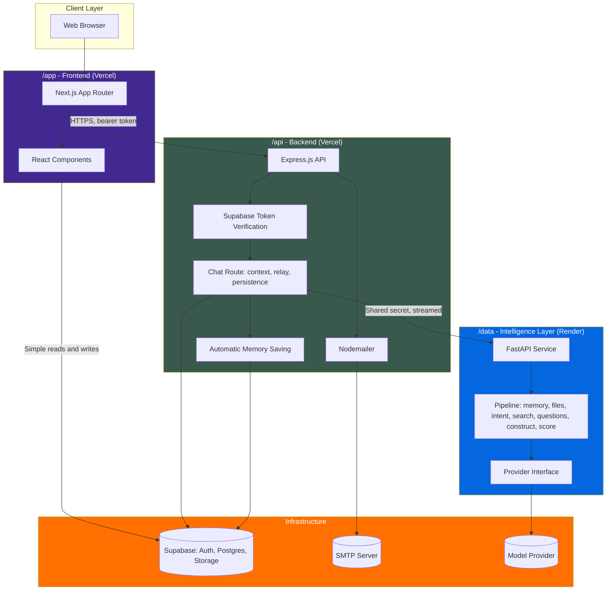
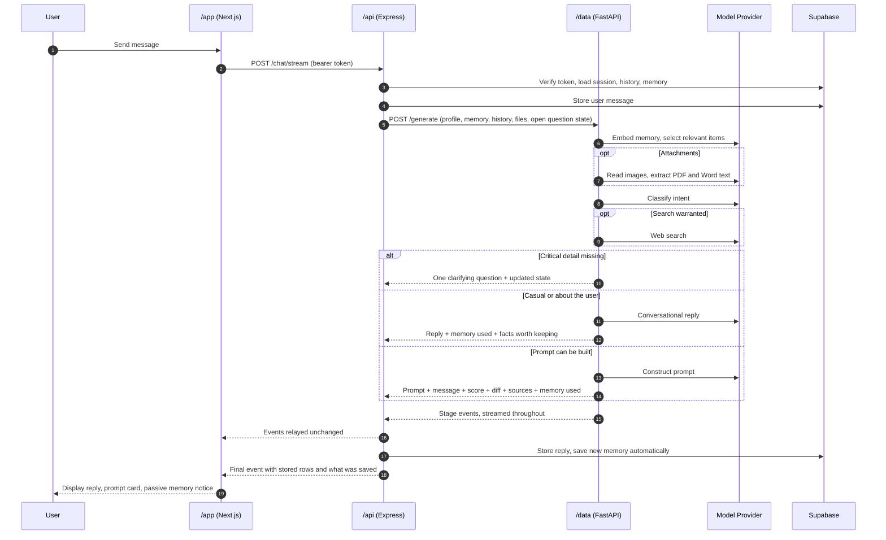
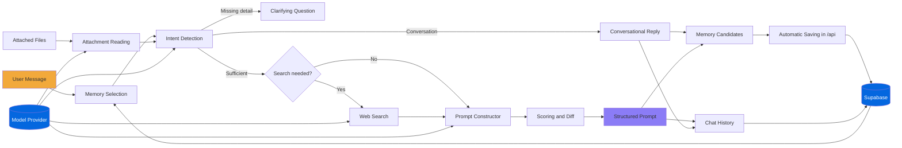
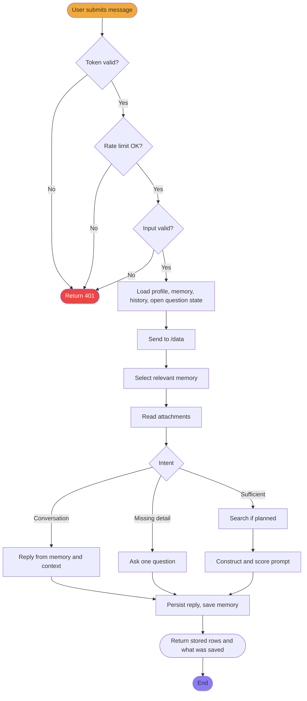
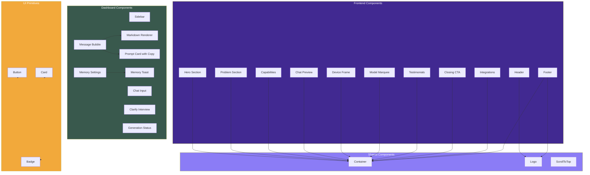

# Prompt AI

Prompt AI is a chat based tool that turns vague human intent into detailed, structured prompts that other AI tools can execute correctly on the first try. You describe what you want in plain language. Prompt AI asks the right questions, fills in the missing context, and returns a prompt built for the AI tool you actually need, whether that is a coding assistant, an image generator, a video model, or a general purpose chat model.

Live site: https://prompt-swe.vercel.app
Repository: oyedokunken/Prompt-AI
Developed by: [oyedokunken](https://www.oyedokun.dev/) ([oyedokunken@gmail.com](mailto:oyedokunken@gmail.com))

This project is public and open to contributors. It is built for developers, by a developer, and it stays that way for now.

---

## Table of Contents

- [The Problem](#the-problem)
- [How Prompt AI Solves It](#how-prompt-ai-solves-it)
- [Architecture Overview](#architecture-overview)
- [System Diagrams](#system-diagrams)
- [Monorepo Structure](#monorepo-structure)
- [Tech Stack](#tech-stack)
- [Core Features](#core-features)
- [Edge Cases We Actively Handle](#edge-cases-we-actively-handle)
- [Getting Started](#getting-started)
- [Environment Variables](#environment-variables)
- [Authentication](#authentication)
- [Running the Project](#running-the-project)
- [Project Roadmap](#project-roadmap)
- [Contributing](#contributing)
- [Documentation](#documentation)
- [License](#license)
- [Contact](#contact)

---

## The Problem

Most people know what they want but do not know how to describe it in a way an AI model can act on without guessing. The gap between "write me a blog post" and a prompt that actually produces a usable blog post is made up of dozens of unstated assumptions: audience, tone, length, structure, platform, constraints, and format. Every AI model, no matter how capable, fills that gap with its own guesses, and those guesses are usually wrong.

Prompt AI exists to close that gap before the prompt ever reaches the target model.

## How Prompt AI Solves It

Prompt AI treats prompt writing as three separate, solvable problems instead of one vague one.

1. **Intent Understanding.** The system identifies what the user is actually trying to accomplish, what information is missing, and which category of AI tool the request belongs to (code generation, image generation, video generation, writing, or agent based tasks).
2. **Prompt Construction.** Using proven prompt engineering patterns such as role definition, context, constraints, output format, and examples, Prompt AI builds a complete, structured prompt from the user's raw input.
3. **Scoring and Iteration.** Every generated prompt is scored against a rubric covering clarity, specificity, constraints, and format. The user sees the score, sees what was added or assumed, and can refine before copying the final prompt out to the destination AI tool.

The long term goal is a system that understands how other AI models think better than most humans do, and uses that understanding to write prompts on the user's behalf, while always showing the user exactly what was inferred versus what they actually said.

## Architecture Overview

Prompt AI is a monorepo split into three services, each with a single responsibility.

- **`/app`** is the Next.js frontend. It owns the chat interface, the dashboard and settings, and everything the user sees.
- **`/api`** is the backend. It owns authentication, the database, email (via Nodemailer), rate limiting, and all business logic that is not AI. For every chat turn it loads the user's profile, stored memory and conversation history, sends them to `/data`, relays the streamed result unchanged, and persists the outcome. It is the only service allowed to talk to `/data`.
- **`/data`** is strictly the intelligence layer. It is stateless, with no database and no direct client access. It receives everything it needs from `/api` and runs the pipeline: select relevant memory, read attachments, detect intent, search the web when current information is needed, run the one question at a time clarifying flow, construct the prompt, and score it. It is the only service that calls a model provider, and it does so through a provider interface.

Three rules keep these boundaries honest: `/data` is the only caller of a model provider, `/api` is the only caller of `/data`, and `/data` never fetches anything itself. That last rule is what keeps the system from guessing about a user it was never told about. See [ARCHITECTURE.md](./ARCHITECTURE.md) for the full request flow and a responsibility table.

`/app` and `/api` are deployed as two separate Vercel projects, linked by environment variables. `/data` is deployed on Render, since Render is better suited to long running Python processes than serverless functions are. Nodemailer runs from `/api` on Vercel rather than from `/data`, since Render does not handle SMTP style outbound mail as cleanly.

## System Diagrams

### Architecture Diagram



### Sequence Diagram



### Data Flow Diagram



### Activity Diagram



### Component Diagram



## Monorepo Structure

```
Prompt-AI/
├── app/               Next.js chat interface and user dashboard (Vercel)
├── api/                Auth, business logic, email, and orchestration (Vercel)
├── data/               Python LLM and ML layer, model serving only (Render)
├── .github/            CI workflows and issue and PR templates
├── .githooks/          Commit hooks, enable with git config core.hooksPath .githooks
├── SECURITY.md
├── CONTRIBUTING.md
├── CHANGELOG.md
├── ARCHITECTURE.md
├── WIKI.md
├── story.txt
└── README.md
```

Each folder is independently runnable and has its own dependency management, environment file, and README with service specific setup instructions.

## Tech Stack

### `/app` - Frontend

| Concern | Technology | Notes |
|---|---|---|
| Framework | Next.js | App Router, SSR + Client Components |
| Language | TypeScript | Strict mode, full type coverage |
| Styling | Tailwind CSS | Custom design tokens, JIT |
| Auth client | Supabase SSR | Session cookies, PKCE OAuth flow |
| Icons | Lucide React | Consistent icon set |
| Animations | Framer Motion | Page transitions, scroll animations |
| Validation | Zod | End-to-end type-safe form schemas |
| Rich text | react-markdown + remark | Replies render as formatted text, raw HTML is never rendered |
| Font | Geist / Geist Mono | Variable fonts, system fallback |
| Deploy | Vercel | Edge network, auto-deploy from `main` |

### `/api` - Backend

| Concern | Technology | Notes |
|---|---|---|
| Framework | Express.js | TypeScript, modular routes |
| Language | TypeScript | Compiled via `tsc`, strict mode |
| ORM | Prisma | Schema and migrations for auth tables |
| Database | PostgreSQL | Hosted on Supabase |
| Auth | Supabase token verification | Every chat request carries a Supabase access token that `/api` verifies |
| Sign up | Email one time codes | HMAC-SHA256 hashed with a pepper, 10 minute expiry, single use |
| OAuth | Supabase Auth | GitHub + Google, redirect-based PKCE |
| Email | Nodemailer | OTP + transactional email via SMTP |
| Security | Helmet + express-rate-limit | Security headers, per-route IP rate limits |
| Validation | Zod | Schema-driven, fails fast on bad input |
| AI relay | fetch + server-sent events | Sends context to `/data` and relays its stream unchanged, never calls a model provider |
| Memory | Supabase Postgres | Automatic saving with guards against secrets, repeats and overwriting manual entries |
| File storage | Supabase Storage | Avatars, image, video, PDF attachments |
| Deploy | Vercel | Separate project from `/app` |

### `/data` - Intelligence Layer

| Concern | Technology | Notes |
|---|---|---|
| Framework | FastAPI | Python, async, internal only, stateless |
| Config | pydantic-settings | Validated at startup, refuses to run on a missing or malformed key |
| Model access | OpenAI API behind a provider interface | Chat, vision, embeddings, web search and transcription, in one implementation |
| Memory retrieval | Embeddings + cosine similarity | Selects relevant stored memory, keyword fallback if embeddings fail |
| Documents | pypdf + python-docx | PDF and Word text extraction |
| Pattern retrieval | In-process vector index | Known effective prompt patterns retrieved by meaning, behind an interface a database store could replace |
| Prompts | Versioned templates | Active version selected in one place, every result traceable to its wording |
| Quality | pytest + evaluation harness | Unit tests, plus an eval set with decision, content, filler and judged scoring |
| Deploy | Render | Long-running Python processes |

### Infrastructure and Tooling

| Concern | Technology |
|---|---|
| Version control | GitHub |
| CI | GitHub Actions (keep alive, commit trailer check) |
| Commit hygiene | `.githooks/commit-msg` + CI check | Strips and rejects AI co-author trailers |
| Code style | ESLint + Prettier |

## Core Features

- **Conversational prompt building.** Describe your goal in natural language and get follow up questions when critical context is missing. Questions come one at a time, with quick options for choices. A single choice advances the moment you pick it.
- **Structured prompt output.** Every generated prompt is shaped by the request instead of copied from a template, with the role, constraints and output format the task needs. It appears in its own card with a copy button, apart from the conversational reply around it.
- **Known effective patterns.** For each request, the closest proven patterns for that kind of task (a support agent, a code review, an extraction, a speech) are retrieved by meaning and used as craft guidance, and the patterns used are shown on the result.
- **Lightweight by default.** Prompts are written as clean plain text so they paste anywhere. Markdown or tagged sections are used only when the destination calls for them.
- **Completeness scoring.** Each prompt is scored against a clarity and specificity rubric, with a visible breakdown of the score.
- **Assumption transparency.** A visible breakdown of what you stated, what was found in your files or on the web, and what was inferred, so you can see exactly where each part of the prompt came from.
- **Reads your material.** Attach a PDF, a Word document or an image. Text is extracted, images are read with vision, and what is found shapes the prompt. Every source is listed.
- **Web search when it matters.** When a request depends on current information, Prompt AI searches the web and shows what it searched and found.
- **Memory that works for you.** Stable facts about you are saved automatically as you chat, with a quiet notice and nothing to approve, and secrets are never stored. The memory that bears on each message is selected before every reply, and you can see which details informed it. A memory page in settings describes what is stored in a few natural sentences, and lets you add, edit and remove anything.
- **Natural conversation.** Casual, off topic and personal messages get a real reply that uses your name when it fits, your stored context, and your conversation, instead of forcing every message into prompt construction.
- **Honest about what it knows.** Asked what it knows about you, it answers only from what is stored, and says so plainly when it has nothing.
- **Live voice input.** Speak a message and the text appears in the box as you talk, phrase by phrase, then review it and send. If live transcription cannot connect, the whole recording is transcribed when you stop instead.
- **Real web lookups.** Ask who a specific person is, or about any real world fact that is not in your memory, and Prompt AI searches the web, shows a Searching the web status, and answers from what it found with the sources listed. Questions about you are answered from memory instead, and it says so plainly when nothing is stored.
- **Change your password.** Accounts that sign in with an email and password get an Accounts tab in settings to change it, with the current password confirmed first and the result shown in a modal. Google and GitHub accounts do not see it.
- **Pinned chats.** Pin a chat from its menu or from inside the chat and it moves to a Pinned group at the top of the chat list, above everything else. Unpin it to return it to its usual place.
- **Feedback on every response.** A thumbs up or thumbs down is stored with the request, the score and the template version, so a person can review where the system falls short and decide what to change.
- **Prompt history and library.** Every conversation is saved. History opens a summary of each conversation before you step into it, saved prompts open in full with copy and a link back to their chat, and there are favorites, shareable read only links, and export to PDF, Markdown, text and JSON.
- **Built for a phone.** The dashboard and its drawer use larger text, icons and tap targets on small screens, and every chat action is reachable without hover.
- **A preview of what is next.** The Integrations tab in settings lists the tools planned for Prompt AI. It is informational only, nothing there can be connected yet.
- **Usage you can read.** A line graph of prompts, tokens, output length, completeness, clarifying questions and how helpful responses were, with 1 day, 3 day, 7 day, 1 month and 3 month ranges and exact values on hover.
- **Model aware formatting.** The output style is chosen per destination, and the provider layer is built so more target models can be added without touching the pipeline.

## Edge Cases We Actively Handle

- Empty, one word, or gibberish input
- Multi-intent input, where a single message contains more than one distinct request
- Input with no target AI tool specified
- Prompt injection attempts embedded inside the user's own input
- Non-English input
- Extremely long input, such as a pasted document
- `/data` downtime, timeouts, or rate limit responses from external AI providers, reported honestly with a retry instead of a fabricated answer
- Attachments that cannot be read, such as scanned PDFs, password protected files or unsupported types, reported as unreadable rather than silently skipped
- Instructions hidden inside attached files or search results, which are treated as content and never followed
- Secrets and long digit runs offered for memory, which are never stored
- A failed search or an embeddings outage, which degrades quietly instead of blocking the reply
- A message asked mid way through a clarifying sequence, answered without losing the pending question
- Versioning of prompt pattern templates, so previously generated prompts remain reproducible even as the pattern library evolves

## Getting Started

### Prerequisites

- A current LTS release of Node.js
- A current Python 3 release (for `/data` only, which pins its own runtime in `runtime.txt`)
- npm (used across `/app` and `/api`)
- A Supabase project (PostgreSQL and storage)
- An OpenAI API key

### Clone the repository

```bash
git clone https://github.com/oyedokunken/Prompt-AI.git
cd Prompt-AI
```

## Environment Variables

Each service has its own `.env.example` file. Copy it and fill in the values before running that service.

**`/api/.env`** - copy from `api/.env.example`

```
DATABASE_URL=
DATABASE_DIRECT_URL=
SUPABASE_URL=
SUPABASE_SERVICE_ROLE_KEY=
OTP_PEPPER=
SMTP_HOST=          # optional, OTP emails degrade gracefully without this
SMTP_PORT=
SMTP_USER=
SMTP_PASS=
DATA_SERVICE_URL=   # required, the deployed /data service
API_SHARED_SECRET=  # required, must match /data
APP_URL=
ALLOWED_ORIGINS=    # must include the /app origin
```

**`/app/.env.local`** - copy from `app/.env.local.example`

```
NEXT_PUBLIC_SUPABASE_URL=
NEXT_PUBLIC_SUPABASE_ANON_KEY=
NEXT_PUBLIC_API_URL=
NEXT_PUBLIC_SITE_URL=
```

**`/data/.env`** - copy from `data/.env.example`

```
OPENAI_API_KEY=       # the only OpenAI key in the system
API_SHARED_SECRET=    # must match /api, min 16 chars
PORT=
```

`/data` also accepts optional overrides for the model names, the embeddings model and the request timeout, listed in `data/.env.example`.

Environment variables are validated at startup: with Zod on `/api` and pydantic-settings on `/data`. A missing or malformed variable stops the service from starting instead of failing later at request time, and a malformed model provider key is rejected rather than repaired. `API_SHARED_SECRET` must be identical on `/api` and `/data`, since `/data` rejects any request that does not carry it. The model provider key exists only on `/data`.

## Authentication

Prompt AI uses a hybrid authentication system combining Supabase OAuth (Google, GitHub) with a custom email + OTP flow powered by the `/api` service.

### Flows

**Email + OTP registration**
1. User submits email and password on `/signup`
2. Frontend calls `POST /auth/otp/request-signup` on `/api`
3. Backend rejects disposable addresses and existing accounts, generates a 6 digit code, hashes it with HMAC-SHA256 and a secret pepper, and stores it
4. Backend sends the code through Nodemailer using the branded template
5. User enters the code, frontend calls `POST /auth/otp/verify-signup`
6. Backend verifies the code and creates the confirmed account in Supabase, then the user signs in

**Email + password login**
1. User submits email and password on `/login`
2. Frontend calls `supabase.auth.signInWithPassword` directly
3. Supabase issues the session and the frontend redirects to `/dashboard`

**OAuth (Google, GitHub)**
1. User clicks an OAuth button on `/login` or `/signup`
2. Frontend calls `supabase.auth.signInWithOAuth` with the provider
3. Supabase redirects to the provider, which redirects back to `/auth/callback`
4. The callback exchanges the code for a Supabase session, and `/api` sends a one time welcome email
5. Middleware refreshes the session on every request and protects `/dashboard` and `/settings`

**Password reset**
1. User submits email on `/forgot-password`
2. Frontend calls `POST /auth/otp/request-reset`, which always returns the same response whether or not the account exists
3. User enters the code and a new password, frontend calls `POST /auth/otp/verify-reset`

**Chat requests**
1. Every call to `/chat/stream` and `/chat/transcribe` carries the user's Supabase access token as a bearer token
2. `/api` verifies the token with Supabase before touching any data, and every query is scoped to that user

### Security

- **OTP codes**: HMAC-SHA256 hashed with a secret pepper, 10 minute expiry, single use
- **Sessions**: owned by Supabase Auth, refreshed by middleware
- **Service boundary**: `/data` accepts only requests carrying the shared secret, compared in constant time, and its docs endpoints are disabled
- **Rate limiting**: 10 requests per 15 minutes on auth mutations, 20 chat requests per minute per user, 60 requests per minute general
- **Error messages**: generic where specifics would allow email enumeration
- **Password reset**: always returns success regardless of whether the email exists
- **Memory**: secrets, card and account numbers are never stored, and entries a user wrote by hand are never overwritten automatically

### Setup

1. Create a Supabase project and enable Google and GitHub OAuth providers under Authentication > Providers
2. Set redirect URL to `https://your-domain/auth/callback` for each provider
3. Copy `api/.env.example` to `api/.env` and fill in all values including SMTP credentials
4. Copy `app/.env.local.example` to `app/.env.local` and fill in Supabase keys
5. Run `npm run db:migrate` inside `api/` to apply Prisma migrations to your Supabase database
6. Start both services: `npm run dev` in `api/` and `npm run dev` in `app/`

## Running the Project

### `/data`

```bash
cd data
python -m venv .venv
.venv/Scripts/pip install -r requirements.txt     # macOS and Linux: .venv/bin/pip
cp .env.example .env                              # then fill in the key and the shared secret
uvicorn main:app --port 8000
```

### `/api`

```bash
cd api
npm install
npm run dev
```

### `/app`

```bash
cd app
npm install
npm run dev
```

Start `/data` first, then `/api`, then `/app`.

### Tests and evaluation

```bash
cd data && pytest tests                       # unit tests, no network needed
cd data && python evaluation/run_eval.py      # free mock mode, no API key or cost
cd data && python evaluation/run_eval.py --live --full --yes --judge   # a deliberate real run, about $0.50
cd api && npm test
```

The eval set is a collection of requests with notes on what a good result looks like. By default it runs offline against a scripted provider, so routine iteration costs nothing, and a real run has to be asked for explicitly. See `data/COST_AUDIT.md` for what a turn costs. It checks decisions, required and forbidden content, formatting, filler phrases and memory behavior, and `--judge` also scores generated prompts with a reviewer model. Run it before and after any change to the prompt templates.

## Project Roadmap

**Now**
- [ ] Stronger prompt craft: keep pushing the eval set and judged scores on specificity and filler
- [ ] More target model providers behind the existing provider interface
- [ ] A larger, harder eval set covering more ambiguous and multi step requests

**Next**
- [ ] Retrieval of known effective prompt patterns to inform construction
- [ ] A `/models` page showing supported target AI models
- [ ] Multi category support (image, video, writing, agents)
- [ ] Moving attachment storage to cover Word documents

**Later**
- [ ] A trained scoring model replacing the rubric based score
- [ ] `/rules` for user defined generation preferences
- [ ] `/community` and `/feedback`
- [ ] Public API for third party integration

## Contributing

Prompt AI is open source and built in public. Contributions of any size are welcome, from fixing a typo to designing a new ML pipeline. See [CONTRIBUTING.md](./CONTRIBUTING.md) for the full process.

This project is currently focused on developers as its primary audience. Feature requests and contributions should keep that audience in mind.

## Documentation

- [ARCHITECTURE.md](./ARCHITECTURE.md) for how the three services fit together and how a request flows through the system
- [SECURITY.md](./SECURITY.md) for how to report a vulnerability
- [CHANGELOG.md](./CHANGELOG.md) for release history
- [story.txt](./story.txt) for why this project exists
- [WIKI.md](./WIKI.md) for the documentation index
- Folder level READMEs in `/app`, `/api`, and `/data` for service specific setup

## License

This project is licensed under the MIT License. See the `LICENSE` file for details.

## Contact

Built by oyedokunken.

- Website: https://www.oyedokun.dev/
- Email: oyedokunken@gmail.com
- Repository: https://github.com/oyedokunken/Prompt-AI

If you are interested in contributing, testing early builds, or just want to talk through the architecture, reach out directly.